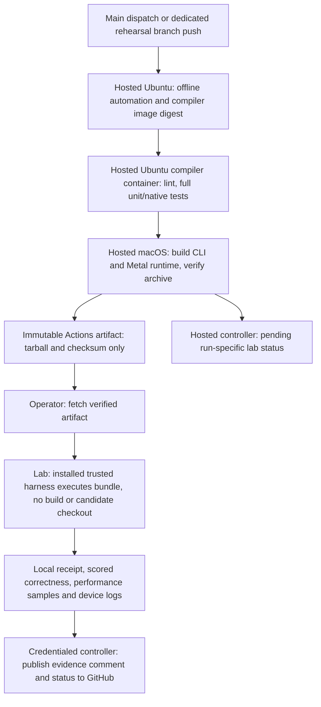

# Hosted builds, artifact-only lab qualification

This is an **opt-in alternative**, initially for macOS ARM64 Metal. It does not
replace `ci.yml`, PR admission, Spark inference, releases, or their required
checks. Production admission is manual and protected-main only. An explicit
exact-SHA rehearsal route permits pre-merge testing from this repository, with
separate non-certification statuses. Existing lab accounts and isolation remain unchanged.



## What runs where

- GitHub-hosted **Ubuntu x64** runs `just ci-automation` on the standard image,
  then binding checks, `just lint`, `just test` and `just llama-check` in the existing compiler image,
  resolved to a digest. These are the existing full quality commands, not new
  reduced unit-test substitutes. They do not prove macOS-specific unit tests.
- GitHub-hosted **macOS ARM64** builds the backend-neutral CLI and Metal runtime
  with the existing `ci-package` action. It verifies startup and archive contents
  without GPU inference. There are no self-hosted runners or lab credentials in
  this workflow. Source and package builds retain existing read-only permissions.
- The **lab** receives the exact packaged CLI/native libraries. A preinstalled,
  trusted harness verifies provenance, runs Qwen3 GPU smoke with positive Metal
  offload, scores the fixture-specific arithmetic/JSON/code repeat checks, and measures
  three serial requests after one warm-up. It builds nothing, installs no test
  dependencies, fetches no model and executes no scripts from the artifact.
- A **credentialed controller** fetches and reports. This can be the existing
  operator/control host; it need not be the execution machine. A one-shot pull
  command is provided, not a new daemon or Actions runner. An existing scheduler
  can invoke it; scheduling and credential provisioning are external setup.

`ci/lab-quality.json` belongs to the pinned Qwen3-0.6B Q8_0 fixture, not the
larger-model Spark ladder. It retains exact expected text, identical repeats and
positive token counts. Arithmetic asks for a completed equation; JSON explicitly
specifies spacing. These cases passed twice each on CPU (`--n-gpu-layers 0`) and
Metal with the same pinned GGUF and hosted `557bbea` bundle before admission.
This is a CPU-backend reference, not an independent runtime implementation.
The initial [rehearsal failure](https://github.com/Mesh-LLM/skippy/commit/557bbea324b4aa2f66733de670867dda6502c11b#commitcomment-211813926)
remains published: reusing the larger-model prompts failed strict formatting.
Neither `ci/inference-quality.json` nor its default scoring behavior changes.

The measurement is **warm end-to-end HTTP output tokens/second**, including
prefill and potentially warm prefix caches. It is not decode-only speed, a
performance improvement claim, a baseline regression gate, multi-node evidence,
or the full family/Spark certification suite. No hardware success is inferred
from compilation or an offline test. Missing hardware/model or failed cleanup
fails the attempt.

## Production operator commands

Install a reviewed, clean harness checkout from protected main on the control
and execution machines. Python 3.12, Just, Git and curl are harness prerequisites;
GitHub CLI is needed only for fetch/report. Do not update the harness from a
candidate artifact or execute these commands in a candidate checkout. For the
initial lane, the hardware machine must run macOS ARM64 with working Metal.

```sh
# On the control host, after this workflow has reached main:
gh workflow run hosted-lab.yml --repo Mesh-LLM/skippy --ref main
# Select the completed run's numeric ID from Actions; do not select "latest"
# implicitly. The workflow leaves lab/metal/<run>.<attempt> pending.
just lab-artifact fetch 123456 /absolute/evidence/123456

# Transfer that directory to the execution machine using existing lab transport.
# This phase requires no GitHub authentication. The model is an already present,
# digest-verified Qwen3 dense fixture from ci/llama-canary/model-fixtures.json.
SKIPPY_CI_MODEL=/absolute/models/pinned-qwen3.gguf \
  just lab-artifact run /absolute/evidence/123456

# Transfer the complete directory back to the control host, including failed
# results and logs. Report failures too; do not use `run && report`.
just lab-artifact report /absolute/evidence/123456
```

Run one qualification at a time on reserved hardware. The command does not add
lab scheduling, machine reservation or isolation. Keep the evidence directory
outside the harness checkout and preserve it after failures. A result is written
on ordinary failure and cancellation; a power loss can leave only partial logs.
Such an interruption leaves GitHub pending and must not be represented as success.

Control operations need **Actions read, Contents write** (commit comments), and
**Commit statuses write** on this repository. An existing operator `gh` login
with private-repository access can publish comments/statuses; a new GitHub App
is not required. Fetch needs only read access. Keep these credentials on the
control host, never in the bundle or execution environment. Supply
credentials at invocation time; the executable's `--version` and inference
processes receive a minimal environment and temporary HOME, not the controller's
environment. This does **not** prevent a process running under the same OS user
from reading that user's files: keep a persistent `gh` login on the control host,
not the execution account. This is credential placement, not a new isolation
requirement. No credentials are embedded in repository files or artifacts.

## Pre-merge rehearsal (same PR, no main push)

An operator deliberately pushes the reviewed candidate to `lab-rehearsal/**`.
This runs the **same** plan, quality, package and handoff jobs from that commit;
it does not create another PR or require workflow registration on main. Only
repository writers can push there. Fork events and ordinary branch pushes are
not admitted. The handoff creates `lab-rehearsal/metal/<run>.<attempt>`, never
`lab/metal/...`.

```sh
# From the reviewed PR worktree. This also pins the harness for this attempt.
sha=$(git rev-parse HEAD)
git push origin "$sha":refs/heads/lab-rehearsal/217
# Select that exact successful Actions run, then approve its SHA explicitly:
just lab-artifact fetch 123456 /absolute/evidence/123456 --rehearsal "$sha"
# Existing transport takes only the verified bundle to the reserved machine.
SKIPPY_CI_MODEL=/absolute/models/pinned-qwen3.gguf \
  just lab-artifact run /absolute/evidence/123456 --rehearsal "$sha"
# Back on the control host, publish success OR failure:
just lab-artifact report /absolute/evidence/123456 --rehearsal "$sha"
```

The operator must review and install the harness at that **same approved SHA**
on the execution machine before running it. This is a deliberate exception to
the production main-only harness policy, not permission to execute scripts
shipped in the artifact or automatically update the harness from a branch.
Installing the harness needs no candidate build or model/dependency download.
A changed harness requires a fresh hosted build and new explicit SHA approval.
Each command requires `--rehearsal`; omitting it cannot promote rehearsal input
into production. Run rejects a different harness SHA before starting the binary.

Published evidence says **REHEARSAL, not certification**. The real download,
archive verification, GPU smoke, correctness, throughput and publication paths
are shared with production. A successful rehearsal proves that path for its
recorded candidate and hardware, not every platform or release readiness.
Existing credentials, accounts and isolation are unchanged. Link the evidence comment in the PR and retain the rehearsal branch through
review so the tested commit remains reachable, including after a squash merge.
Remove the temporary branch only once its evidence is durably retained.

## Admission and evidence

Production fetch requires a successful `workflow_dispatch` from this repository, the exact
workflow path, a source SHA on protected `refs/heads/main`, and successful plan,
quality, package and main-only handoff jobs in the **current attempt**. A tag
named `main`, a skipped handoff, expired artifact, changed attempt or a branch
build cannot substitute for these checks. The separately named rehearsal push route above is never admitted as production.
A new workflow cannot be dispatched before its file reaches the default branch;
the dedicated push trigger avoids that bootstrap dependency.

The artifact name binds run and attempt; GitHub's ZIP SHA-256, the product
checksum, its full file roster, native platform/backend and expected source SHA
are verified. Only the tarball and checksum enter the lab directory; producer
reports cannot masquerade as lab evidence. Model identity, harness commit,
chip/model/memory, OS build, workload, samples, device logs and archive digest
are retained. The trusted harness may be newer than the binary; report requires
its recorded commit to be on protected main too (or the explicitly approved rehearsal SHA).

Report rechecks the source/attempt and evidence hashes, requires the pending
handoff status, publishes structured JSON plus device-log excerpts as a GitHub
commit comment, and links the run-specific commit status to it. Oversized structured
responses are published as explicitly truncated previews; their complete file
hashes and full local files remain available. A successful hosted build
is therefore visibly distinct from lab success. Complete logs stay in the
operator's evidence directory; their hashes are published. GitHub permissions,
artifact retrieval and report publication need a live rehearsal before this
becomes a required gate. A failed evidence publication cannot mark the lab green.

After reporting, repeat qualification with a **new workflow run/attempt**, not by
overwriting that run's status. Full reruns must execute all four hosted jobs;
partial reruns do not inherit qualification authority. GitHub copies inherited jobs
into its attempt-specific API response, so admission also requires every job's
execution start to be at or after that attempt's start. Run-specific contexts
preserve prior outcomes and prevent an old green from qualifying new bytes.
They are intentionally not a stable branch-protection/release gate yet.

## Validation and rollout

`just ci-automation` includes offline admission, digest, extraction, provenance,
failure/reporting, endpoint-routing and bounded-performance contracts. These
fixtures do not establish hardware operation or hosted image capacity.

Before expanding or switching over: rehearse the candidate, collect a real hosted bundle,
qualify it on Metal, publish the receipt, demonstrate a failed result and a stale
attempt rejection, then design the CUDA/ROCm/Windows and full certification lanes
around the same binary boundary. Release promotion must ultimately consume the
exact tested archive, never rebuild it. This PR intentionally does not change
that promotion policy or weaken existing gates.
