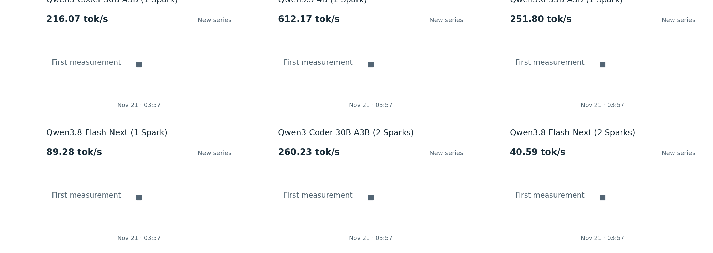
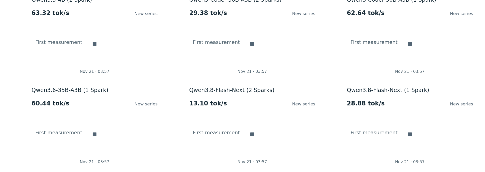

# Inference qualification

**0 regressions · 0 improvements · 0 within tolerance · 12 first measurements**

21 Nov 2026 03:57 UTC · Engine `3f34c26a1811` · pr · Qualification: Passed · **Tolerance: ±1%** · NVIDIA GB10 DGX Spark

6 measured configurations. Counts refer to performance metrics. First measurements establish new series and have no trend verdict.

## Performance over time

Each panel shows one measured model and hardware configuration. The dashed line is the current comparison reference; the shaded band is ±1%. Blue circles are within tolerance, green triangles indicate improvements, red triangles indicate regressions, and grey squares mark first measurements. Missing measurements leave gaps. Dates are UTC.

### Prefill throughput

Higher is better.

### Decode throughput

Higher is better.

## Latest numbers

Current values and signed changes against the saved reference, or the previous comparable measurement when no saved reference exists. Higher throughput and lower latency are better.

### One Spark

| Model | Prefill throughput (tok/s) | Decode throughput (tok/s) |
| --- | --- | --- |
| Qwen3.5-4B (1 Spark) · Smoke test (v1) | 612.17 (New series) | 63.32 (New series) |
| Qwen3-Coder-30B-A3B (1 Spark) · Smoke test (v1) | 216.07 (New series) | 62.64 (New series) |
| Qwen3.6-35B-A3B (1 Spark) · Smoke test (v1) | 251.80 (New series) | 60.44 (New series) |
| Qwen3.8-Flash-Next (1 Spark) · Smoke test (v1) | 89.28 (New series) | 28.88 (New series) |

### Two Sparks

| Model | Prefill throughput (tok/s) | Decode throughput (tok/s) |
| --- | --- | --- |
| Qwen3-Coder-30B-A3B (2 Sparks) · Smoke test (v1) | 260.23 (New series) | 29.38 (New series) |
| Qwen3.8-Flash-Next (2 Sparks) · Smoke test (v1) | 40.59 (New series) | 13.10 (New series) |

## Measurement notes

Smoke throughput uses scored request token totals divided by measured phase time. It is a different workload from nightly AgentX.

The ±1% rule expresses tolerance, not statistical significance. Comparisons preserve workload identity; a changed benchmark starts a new series.

[Source run](https://github.com/Mesh-LLM/skippy/actions/runs/44863668933)
