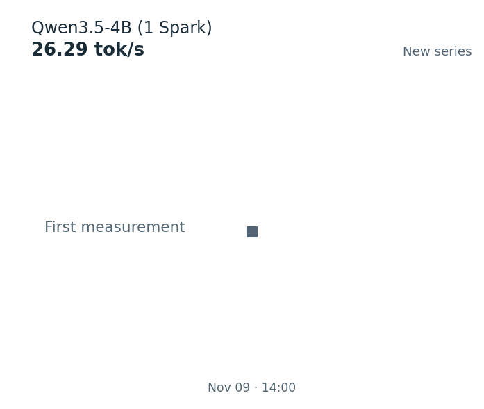
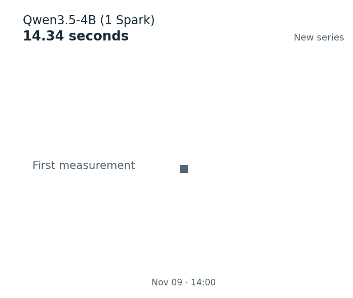
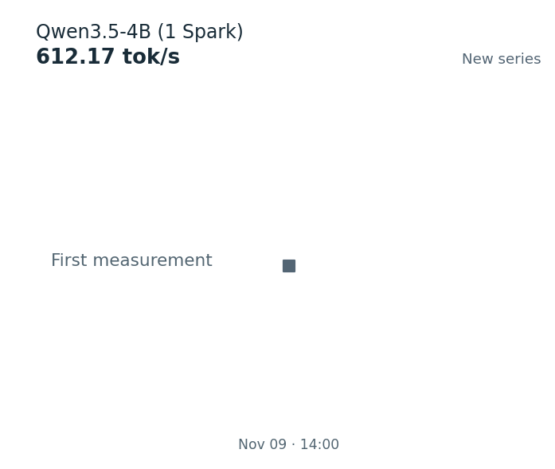
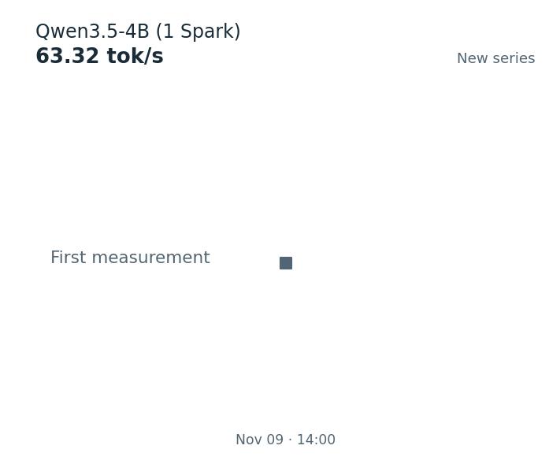

# Inference qualification

**0 regressions · 0 improvements · 0 within tolerance · 4 first measurements**

09 Nov 2026 14:00 UTC · Engine `aaaaaaaaaaaa` · nightly · Qualification: Passed · **Tolerance: ±1%** · NVIDIA GB10 DGX Spark

2 measured configurations. Counts refer to performance metrics. First measurements establish new series and have no trend verdict.

## Performance over time

Each panel shows one measured model and Spark configuration. The dashed line is the current comparison reference; the shaded band is ±1%. Blue circles are within tolerance, green triangles indicate improvements, red triangles indicate regressions, and grey squares mark first measurements. Missing measurements leave gaps. Dates are UTC.

### Output throughput

Higher is better.

### Time to first token

Lower is better.

### Prefill throughput

Higher is better.

### Decode throughput

Higher is better.

## Latest numbers

Current values and signed changes against the saved reference, or the previous comparable measurement when no saved reference exists. Higher throughput and lower latency are better.

### One Spark

| Model | Output throughput (tok/s) | Time to first token (seconds) | Prefill throughput (tok/s) | Decode throughput (tok/s) |
| --- | --- | --- | --- | --- |
| Qwen3.5-4B (1 Spark) | 26.29 (New series) | 14.34 (New series) | — | — |
| Qwen3.5-4B (1 Spark) | — | — | 612.17 (New series) | 63.32 (New series) |

## Measurement notes

Two trials per configuration. Throughput and latency values are means of trial summaries. Latency is the mean of trial p95 values, not a pooled p95.
The ±1% rule expresses tolerance, not statistical significance. Comparisons preserve workload identity; a changed benchmark starts a new series.

[Full results and history](https://huggingface.co/datasets/meshllm/skippy-inference-qualification/tree/main/runs)
