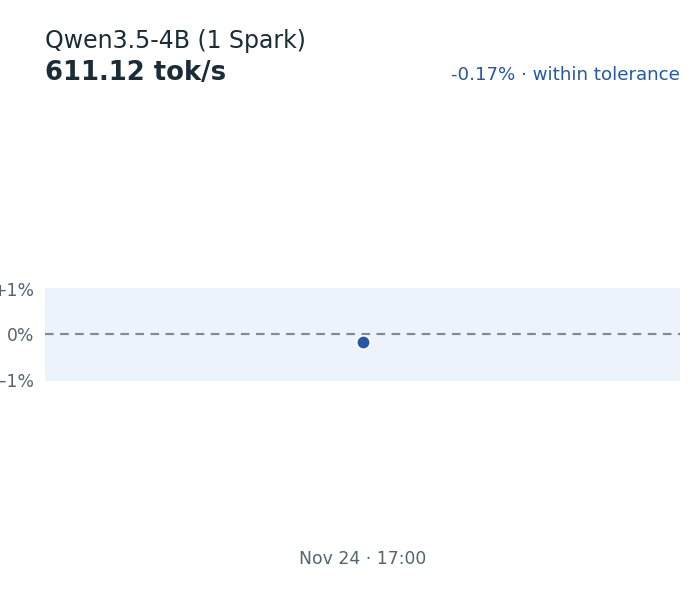
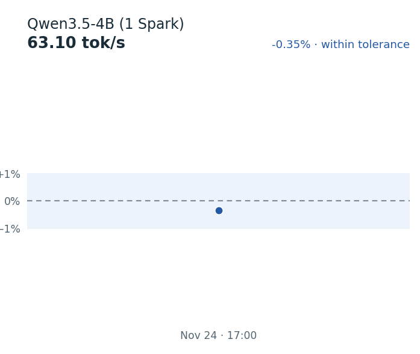

# Inference qualification

**0 regressions · 0 improvements · 2 within tolerance · 0 first measurements**

24 Nov 2026 17:00 UTC · Engine `dddddddddddd` · pr · **Tolerance: ±1%** · NVIDIA GB10 DGX Spark

1 measured configurations. Counts refer to performance metrics. First measurements establish new series and have no trend verdict.

## Performance over time

Each panel shows one measured model and Spark configuration. The dashed line is the current comparison reference; the shaded band is ±1%. Blue circles are within tolerance, green triangles indicate improvements, red triangles indicate regressions, and grey squares mark first measurements. Missing measurements leave gaps. Dates are UTC.

### Prefill throughput

Higher is better.

### Decode throughput

Higher is better.

## Latest numbers

Current values and signed changes against the saved reference, or the previous comparable measurement when no saved reference exists. Higher throughput and lower latency are better.

### One Spark

| Model | Prefill throughput (tok/s) | Decode throughput (tok/s) |
| --- | --- | --- |
| Qwen3.5-4B (1 Spark) | 611.12 (-0.17% · Within tolerance) | 63.10 (-0.35% · Within tolerance) |

## Measurement notes

Smoke throughput uses scored request token totals divided by measured phase time. It is a different workload from nightly AgentX.

The ±1% rule expresses tolerance, not statistical significance. Comparisons preserve workload identity; a changed benchmark starts a new series.

[Saved baseline snapshot](https://huggingface.co/datasets/meshllm/skippy-inference-qualification/blob/ffffffffffffffffffffffffffffffffffffffff/baselines.json)
